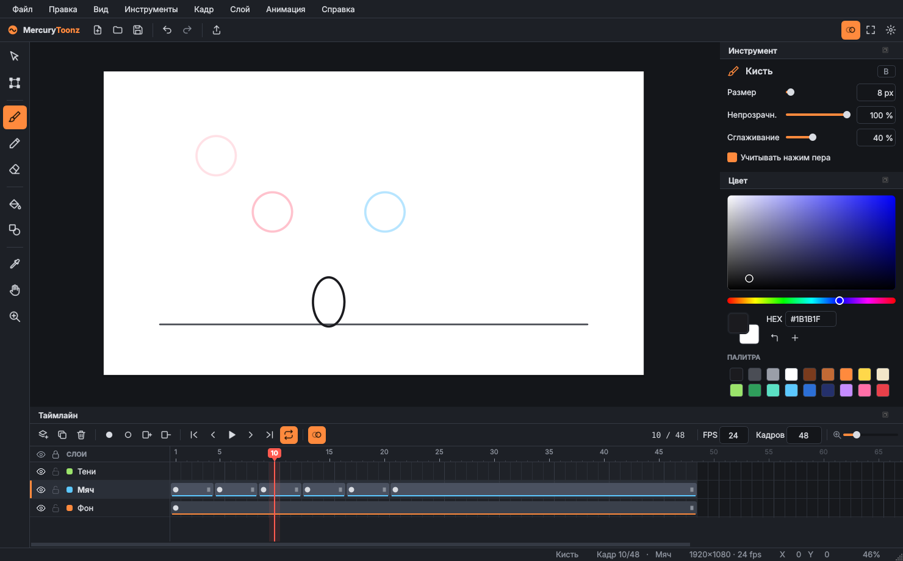

# MercuryToonz

Программа для 2D-анимации на Python + Qt (PySide6): покадровое рисование и анимация по ключевым кадрам.



## Запуск

```bash
cd mercurytoonz
pip install -r requirements.txt
python main.py
```

## Что уже есть (шаг 1 — интерфейс)

- **Холст** с листом сцены 1920×1080, масштабом (Ctrl+колесо, Z) и панорамой (пробел, средняя кнопка, H).
- **Инструменты**: кисть, карандаш, ластик, фигуры (линия / прямоугольник / эллипс), пипетка, рука, масштаб.
  Выделение, трансформация и заливка — пока заглушки.
- **Настройки инструмента**: размер, непрозрачность, сглаживание, нажим пера (планшет).
- **Цвет**: квадрат насыщенности/яркости, полоса тона, HEX, основной и дополнительный цвет, палитра.
- **Таймлайн**: слои (видимость, блокировка, цветная метка, переименование двойным щелчком),
  ключевые кадры и экспозиция, линейка с бегунком, контекстное меню кадра, масштаб ширины кадров.
- **Луковая кожа**: предыдущие рисунки красным, следующие — синим.
- **Воспроизведение** с выбором FPS и зацикливанием.
- **История правок**: отмена и повтор (Ctrl+Z / Ctrl+Shift+Z).
- Меню, горячие клавиши (F1 — справка), строка состояния.

## Устройство кода

```
mercurytoonz/
├── main.py                  точка входа
└── mtoonz/
    ├── app.py               главное окно, меню, действия, горячие клавиши
    ├── model.py             проект: слои, ключевые кадры, рисунки, история правок
    ├── state.py             активный инструмент, цвета, настройки кистей
    ├── theme.py             тёмная тема (QSS)
    ├── icons.py             встроенные SVG-иконки
    └── widgets/
        ├── canvas.py        холст
        ├── timeline.py      таймлайн
        ├── tool_options.py  настройки инструмента
        └── color_panel.py   выбор цвета
```

## Дальше по плану

1. ~~Интерфейс~~
2. Сохранение и открытие проектов
3. Выделение, трансформация, заливка
4. Анимация по ключевым кадрам: объекты, трансформации и промежуточные кадры (tween)
5. Экспорт в MP4 / GIF / PNG
6. Звук на таймлайне
