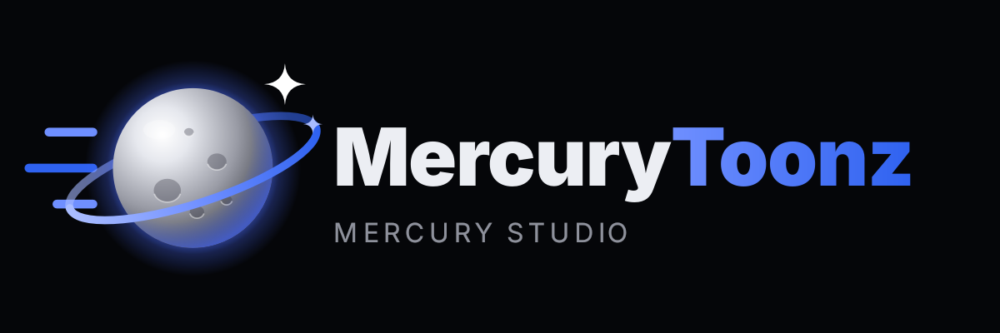
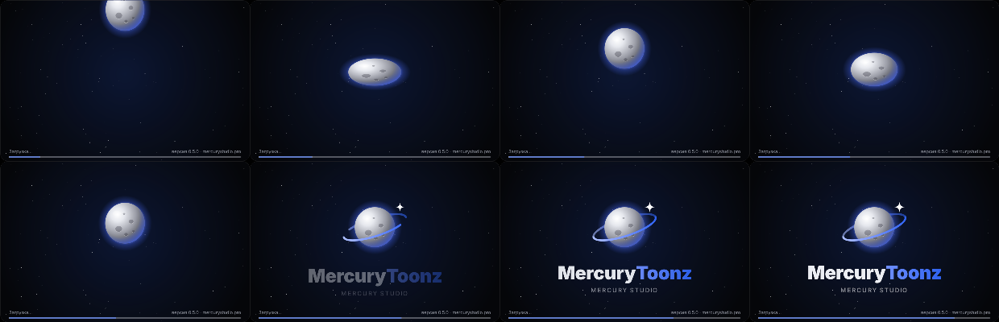
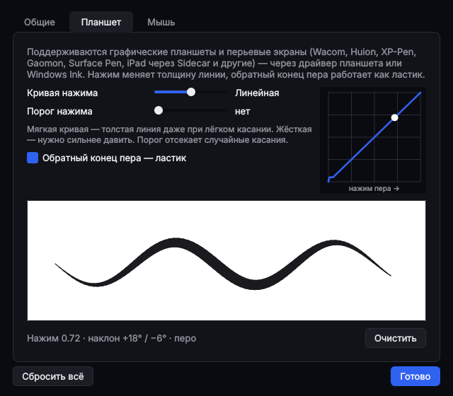
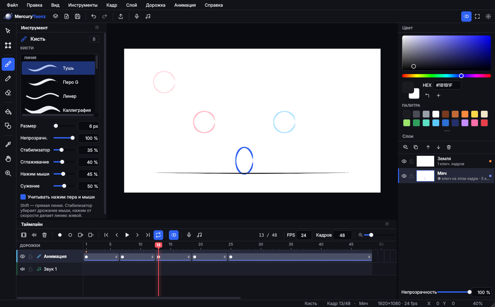
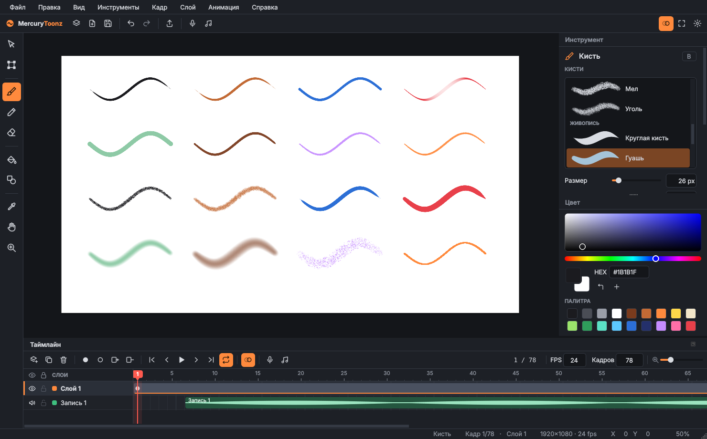
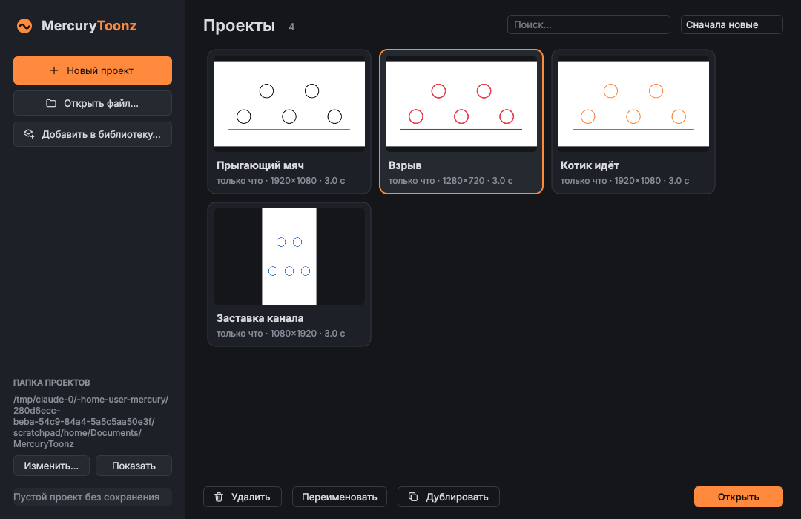

# MercuryToonz



Программа для 2D-анимации и монтажа от [Mercury Studio](https://mercurystudio.pro), на Python + Qt (PySide6):
покадровое рисование, анимация по ключевым кадрам, звуковые дорожки, экспорт в видео.


## Запуск

```bash
cd mercurytoonz
pip install -r requirements.txt
python main.py
```

## Фирменный стиль, заставка и планшеты (шаг 5)



- **Логотип** — серебристая планета Меркурий с синим свечением и кольцом орбиты, в цветах
  Mercury Studio. Файлы: `brand/logo.svg`, `brand/logo.png`, `brand/logo-wide.png`.
- **Заставка при запуске**: планета падает и прыгает со сплющиванием, на каждом ударе — «бум»,
  в конце — звонкий аккорд и название. Звук генерируется программой. Щелчок — пропустить.
- **Графические планшеты** (Wacom, Huion, XP-Pen, Gaomon, Surface Pen и др.): перо обрабатывается
  напрямую — точные координаты и нажим; обратный конец пера — ластик.
- **Настройки** (Ctrl+,): кривая и порог нажима с графиком, площадка для проверки пера,
  дополнительная стабилизация для мыши, вкл./выкл. заставки и звука.



## Дорожки, слои и экспорт (шаг 4)



- **Слева** — настройки инструмента и библиотека кистей. **Справа** — цвет и под ним **панель слоёв**:
  миниатюры, видимость, блокировка, непрозрачность, порядок перетаскиванием.
- **Таймлайн — только дорожки**:
  - «Анимация» — нарисованный мультфильм; на ней ключевые кадры выбранного слоя и риски ключей остальных слоёв;
  - видеодорожки — для видео, картинок и GIF (импорт — следующий шаг);
  - звуковые дорожки — клипы с волной; их можно таскать по времени и между дорожками.
- **Экспорт** (Ctrl+E): MP4, MOV (в том числе ProRes 4444 с прозрачным фоном), AVI, GIF, последовательность PNG,
  MP3. Диапазон кадров, размер, частота, качество, звук, прозрачность, прогресс с отменой.
  FFmpeg ставится вместе с программой (`imageio-ffmpeg`), отдельно устанавливать не нужно.

## Кисти, звук и справка (шаг 3)



- **Пропорции кадра** при создании проекта: 16:9, 9:16 (Shorts, Reels, TikTok), 1:1, 4:5, 4:3, 21:9 или свой размер;
  для каждой — список разрешений от 480p до 4K.
- **16 кистей**: тушь, перо G, линер, каллиграфия, маркер, фломастер, карандаши HB и 6B, мел, уголь,
  круглая кисть, гуашь, акварель, мягкая кисть, аэрограф, пиксель. Ластик жёсткий и мягкий.
- **Удобно даже мышкой**: стабилизатор (кисть плавно тянется за курсором), нажим от скорости
  (быстрее — тоньше), сужение концов линии, сглаживание после отпускания.
- **Прямые и кривые**: Shift при рисовании — прямая линия; «Фигуры → Кривая» — протяните линию и изогните её мышью.
- **Звук**: запись с микрофона прямо в проект (Ctrl+R), во время записи может играть анимация — удобно для озвучки;
  импорт WAV, MP3, OGG, M4A и других (Ctrl+I). Звуковые дорожки на таймлайне с волной, их можно двигать
  и выключать. Звук хранится внутри файла проекта.
- **Справка**: о программе и сборке, история версий, политика конфиденциальности, контакты разработчика, горячие клавиши.

## Проекты и формат файла (шаг 2)



- При запуске открывается **окно проектов**: карточки с обложкой, поиск, сортировка.
  Там же можно создать, открыть, переименовать, дублировать и удалить проект (в корзину).
- Проекты лежат в папке `Документы/MercuryToonz` (папку можно сменить).
- **Файл → Недавние**, Ctrl+S, «Сохранить как», вопрос о несохранённых изменениях при закрытии.
- Свой формат **`.mtoonz`**: ZIP-архив внутри.

  | Файл в архиве | Что внутри |
  |---|---|
  | `meta.json` | имя, даты, размер сцены, число кадров — для быстрого списка проектов |
  | `project.json` | сцена целиком: настройки, слои, ключевые кадры, мазки |
  | `thumbnail.png` | обложка |
  | `media/` | зарезервировано под видео и звук |

  В формате есть номер версии. У каждого слоя есть `id` и `type`. Слои незнакомого типа
  (будущие видео-, аудио- и слои-элементы) старая версия программы не теряет и записывает обратно как есть.

Тесты: `python -m unittest discover -s tests`

## Шаг 1 — интерфейс

- **Холст** с листом сцены 1920×1080, масштабом (Ctrl+колесо, Z) и панорамой (пробел, средняя кнопка, H).
- **Инструменты**: кисть, карандаш, ластик, фигуры (линия / прямоугольник / эллипс), пипетка, рука, масштаб.
  Выделение, трансформация и заливка — пока заглушки.
- **Настройки инструмента**: размер, непрозрачность, сглаживание, нажим пера (планшет).
- **Цвет**: квадрат насыщенности/яркости, полоса тона, HEX, основной и дополнительный цвет, палитра.
- **Таймлайн**: слои (видимость, блокировка, цветная метка, переименование двойным щелчком),
  ключевые кадры и экспозиция, линейка с бегунком, контекстное меню кадра, масштаб ширины кадров.
- **Луковая кожа**: предыдущие рисунки красным, следующие — синим.
- **Воспроизведение** с выбором FPS и зацикливанием.
- **История правок**: отмена и повтор (Ctrl+Z / Ctrl+Shift+Z).
- Меню, горячие клавиши (F1 — справка), строка состояния.

## Устройство кода

```
mercurytoonz/
├── main.py                  точка входа
└── mtoonz/
    ├── app.py               главное окно, меню, действия, горячие клавиши
    ├── model.py             проект: слои, ключевые кадры, рисунки, история правок
    ├── fileformat.py        формат .mtoonz, библиотека проектов
    ├── render.py            отрисовка кадров (холст, обложки, экспорт)
    ├── brushes.py           движок кистей и набор кистей
    ├── audio.py             запись с микрофона, волна, воспроизведение звука
    ├── export.py            экспорт через FFmpeg
    ├── brand.py             логотип, иконка, анимация и звук заставки
    ├── prefs.py             настройки программы
    ├── versions.py          история версий
    ├── state.py             активный инструмент, цвета, настройки кистей
    ├── theme.py             тёмная тема (QSS)
    ├── icons.py             встроенные SVG-иконки
    └── widgets/
        ├── canvas.py        холст
        ├── timeline.py      таймлайн
        ├── project_browser.py  окно проектов, диалог нового проекта
        ├── help_dialog.py   справка
        ├── export_dialog.py окно экспорта
        ├── layers_panel.py  панель слоёв
        ├── splash.py        заставка
        ├── preferences.py   окно настроек
        ├── tool_options.py  настройки инструмента
        └── color_panel.py   выбор цвета
```

## Дальше по плану

1. ~~Интерфейс~~
2. ~~Свой формат файла, создание и удаление проектов~~
3. ~~Пропорции кадра, кисти, рисование мышью, запись звука, справка~~
4. ~~Дорожки отдельно от слоёв, экспорт в MP4, MOV, AVI, GIF, PNG, MP3~~
5. ~~Логотип и фирменный стиль, заставка со звуком, графические планшеты~~
6. Импорт видео, картинок и GIF (мемные вставки): дорожка изображения и звуковые дорожки — отдельными слоями
7. Слои-элементы и анимация по ключевым кадрам: положение, поворот, масштаб, прозрачность, плавные переходы
8. Звук на таймлайне: громкость, обрезка, несколько клипов на дорожке
9. Выделение, трансформация, заливка; папки и группы слоёв
